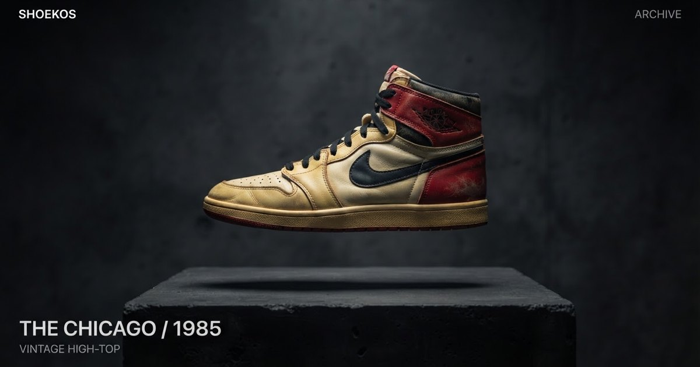

# Shoekos

Landing de e-commerce para un archivo curado de sneakers de colección. Sitio estático en HTML, CSS y JavaScript sin dependencias, sin build.



## Estado

Remaster completo del sitio original: mismo alcance (catálogo de 6 piezas, carrito y contacto), nuevo sistema visual, nueva estructura y suite de pruebas reescrita.

## Ejecución local

```bash
npm install
npm run serve
```

Sirve en `http://127.0.0.1:8080`. Cualquier servidor estático funciona igual. No hay paso de compilación: los archivos se publican tal cual.

## Estructura

```
.
├── index.html              # Home: hero, filtros, catálogo, manifiesto, newsletter
├── compras.html            # Carrito (demo visual) + piezas relacionadas
├── contactenos.html        # Soporte, formulario validado y FAQ
├── assets/
│   ├── css/site.css        # Tokens + todos los componentes (único CSS)
│   ├── js/site.js          # Tema, filtros, búsqueda, carrito demo, validaciones
│   └── img/                # Imágenes de producto (.webp) + og-image
├── docs/stitch/
│   ├── DESIGN.md           # Design system: tokens, tipografía, componentes, páginas
│   └── prompts.md          # Prompts usados para generar los mockups en Stitch
├── tests/                  # Playwright: smoke, carrito, contacto
├── legacy/                 # Versión anterior (Bootstrap + jQuery), no referenciada
├── .nojekyll               # Evita el procesamiento de Jekyll en GitHub Pages
└── playwright.config.ts
```

## Qué hace

| Función | Detalle |
| --- | --- |
| Catálogo | 6 piezas con marca, modelo, talla, año, material y precio en USD |
| Filtros | Por tipo (basquetbol, casual, running, deportivo) con contador en vivo |
| Búsqueda | Filtra el catálogo por marca, modelo o nickname |
| Orden | Destacados, precio asc/desc, año |
| Carrito demo | Añadir desde el home actualiza el badge y muestra un toast; en `compras.html` se cambian cantidades, se eliminan piezas y el total se recalcula |
| Estado vacío | Aparece al eliminar todas las piezas del carrito |
| Tema | Oscuro por defecto, claro opcional; respeta `prefers-color-scheme` y persiste en `localStorage` |
| Contacto | Validación de campos, email y política de datos; FAQ desplegable |
| Newsletter | Validación de correo en cliente |
| Responsive | 3 columnas → 2 → 1, navbar con menú móvil y barra de compra fija en el carrito |
| Accesibilidad | Foco visible, etiquetas asociadas, `aria-*` en controles, contraste AA, `prefers-reduced-motion` |

## Qué no hace

- **No procesa pagos.** El botón “Finalizar compra” solo muestra un aviso de demo.
- **No envía correos.** El formulario valida y confirma en pantalla, sin backend ni servicio conectado.
- **El carrito no persiste entre páginas.** Vive en memoria; al navegar se reinicia con las dos piezas de ejemplo de `compras.html`.
- **No hay cuentas, login ni stock real.** Los productos están escritos en el HTML.
- **No hay panel de administración ni base de datos.**
- **Búsqueda y filtros son del lado del cliente**, sobre las 6 piezas presentes en la página.
- **Sin analítica ni cookies de terceros.**

## Diseño

El sistema visual se generó con **Google Stitch** y se tradujo a CSS propio.

- Proyecto en Stitch: `https://stitch.withgoogle.com/projects/8336219123257505995`
- Design system: [`docs/stitch/DESIGN.md`](docs/stitch/DESIGN.md)
- Prompts de las 12 pantallas (3 páginas × desktop/mobile × dark/light): [`docs/stitch/prompts.md`](docs/stitch/prompts.md)

Decisiones clave:

- **Paleta:** negro `#0A0A0A`, superficies `#121212` / `#1A1A1A`, volt `#DFFF4F`, rojo señal `#FF3B30`; modo claro sobre papel cálido `#F5F4F0`.
- **Tipografía:** Anton (display), Inter (UI), JetBrains Mono (precios, tallas, micro-labels).
- **Forma:** cards de 12 px, inputs de 8 px, botones tipo pill, badges de 4 px. Sin sombras ni gradientes.
- **Modo claro:** el volt solo se usa como relleno; los CTAs primarios pasan a negro sólido.

## Tecnologías

- **HTML5** semántico, sin framework.
- **CSS** con custom properties (tokens), Grid y Flexbox; un solo archivo.
- **JavaScript** sin dependencias ni bundler.
- **Google Fonts** (Anton, Inter, JetBrains Mono) con `preconnect` y `display=swap`.
- **Playwright** para pruebas end-to-end.
- **GitHub Pages** como hosting.

## Pruebas

```bash
npm test
npm run test:headed
npm run test:ui
npm run test:report
```

23 pruebas en Chromium:

- `tests/smoke.spec.ts` — home, catálogo, badges, filtros, búsqueda, carrito, tema, newsletter y navegación.
- `tests/carrito.spec.ts` — totales, cantidades, eliminación, estado vacío y barra móvil.
- `tests/contacto.spec.ts` — validaciones, política de datos y FAQ.

## Imágenes

Las fotos de producto y el hero fueron generadas con Stitch/Gemini para el mockup. Son imágenes sintéticas con siluetas de modelos reales; su uso comercial no está licenciado, por lo que deben reemplazarse por fotografía propia o licenciada.

## Legacy

`legacy/` conserva la versión anterior del sitio (Bootstrap 5 + jQuery, CSS duplicado, carrito con `alert`). No se referencia desde las páginas actuales y se mantiene como referencia histórica.
